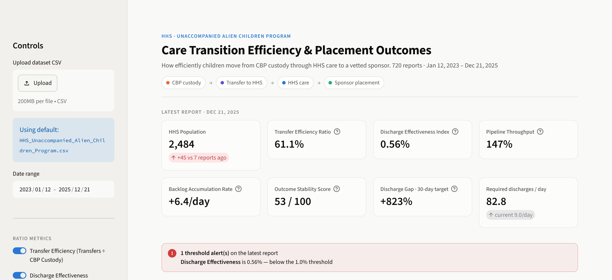
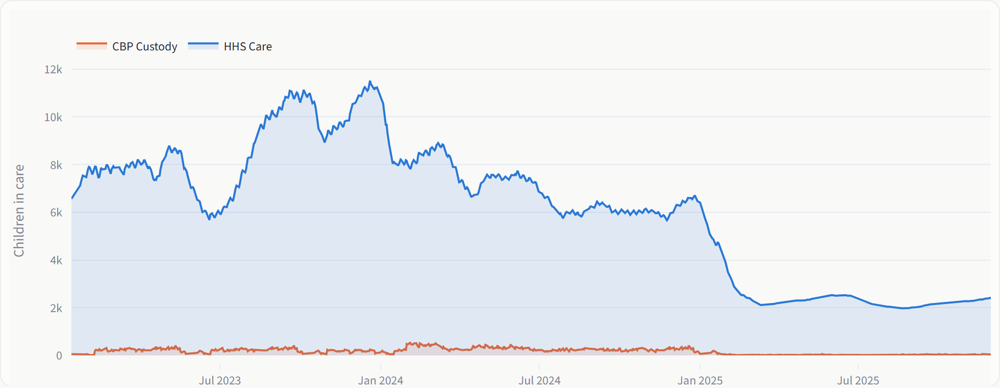
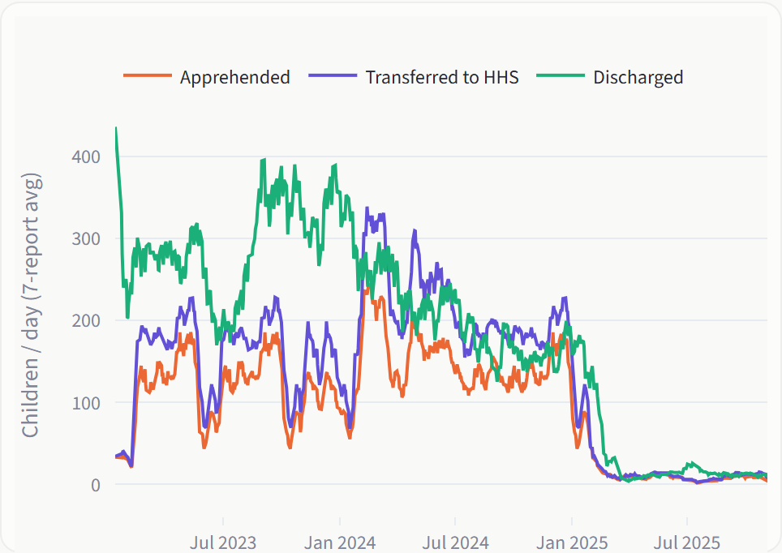
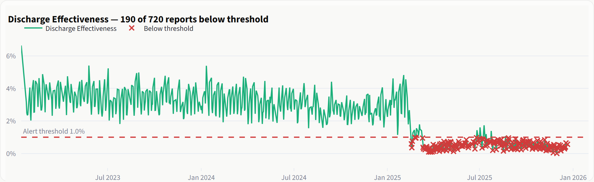
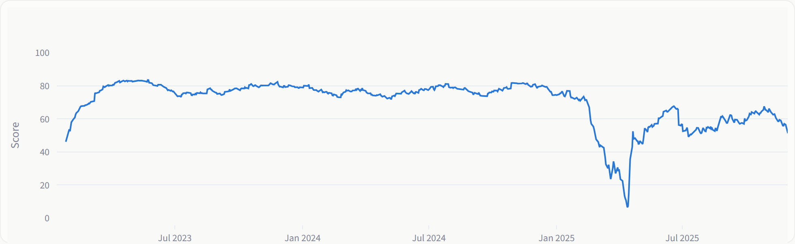

# UAC Care Transition Analytics

A Streamlit dashboard that measures how efficiently unaccompanied children move through the U.S. care pipeline, from CBP custody, to HHS shelters, to placement with a vetted sponsor.

Most public reporting on this program tracks how many children are in custody. This project looks at **flow**: how fast children are transferred, whether discharges keep pace with intake, and when the system stalls.

Built for the Unified Mentor data analytics internship, using 720 daily HHS reports from January 2023 to December 2025.

**Live app:** _link added after deployment_
**Research paper:** [research_paper.md](research_paper.md) · **Executive summary:** [executive_summary.md](executive_summary.md)



## What the data shows

- **Discharges, not intake, were the bottleneck.** HHS care peaked at 11,516 children on December 20, 2023, and fell 78% to 2,484 by December 2025. Most of that drop came from intake falling from about 130 to about 8 children per day.
- **Placement slowed sharply in 2025.** The median daily discharge rate fell from 3.15% to 0.86% of the HHS population after mid-2024 (Mann-Whitney U, p < 0.001).
- **One major stall.** Between February 17 and March 31, 2025, discharges fell to about 24% of their prior 30-day level. The worst stretch lasted 14 reports across 20 calendar days.
- **The current pace can't clear the backlog quickly.** At about 9 discharges per day, clearing 2,484 children within 30 days would need 82.8 per day (+823%). A 90-day target needs 27.6 per day (+208%).
- **Placements became less predictable.** The Outcome Stability Score averaged 77 in 2023–2024 and 54.9 in 2025.

One caution: the dataset shows a large weekday vs. weekend difference, but it comes from the reporting schedule (130 Sunday reports, 2 on Friday, none on Saturday), not from how operations performed. The dashboard flags this rather than presenting it as a finding.

## Dashboard

| | |
|---|---|
|  |  |
| **Pipeline population.** HHS care against CBP custody over three years. | **Inflows vs. outflows.** 7-report averages of apprehensions, transfers and discharges. |
|  |  |
| **Threshold alerts.** Reports below the user-set threshold are marked in red. | **Outcome stability.** Consistency of placements; note the collapse in spring 2025. |

The app has six tabs: Pipeline Flow, Transfer & Discharge, Bottleneck Detection, Outcome Trends, Statistics, and Data (with CSV export).

From the sidebar you can:
- pick a date range; every KPI, chart and alert recalculates
- turn each ratio metric on or off
- set alert thresholds for the three ratios and for backlog growth

## Metrics

| KPI | How it's calculated | What it tells you |
|---|---|---|
| Transfer Efficiency Ratio | Transferred ÷ CBP custody | Speed of the CBP → HHS handoff |
| Discharge Effectiveness Index | Discharged ÷ HHS care | Share of the HHS population placed per day |
| Pipeline Throughput | Total exits ÷ total entries | Above 100% means the system is draining |
| Backlog Accumulation Rate | Change in the 7-report average HHS population | Positive means the backlog is growing |
| Outcome Stability Score | 100 × (1 − coefficient of variation) of discharge effectiveness, 30-report window | 100 = perfectly steady placements |

Stalls are reported in both report counts and calendar days, because reports are not filed every day.

## Running it locally

Requires Python 3.12.

```bash
python -m venv .venv
source .venv/bin/activate        # Windows: .venv\Scripts\activate
pip install -r requirements.txt
streamlit run app.py
```

The app loads the bundled CSV by default. You can upload a newer export from the sidebar.

### Tests

```bash
pip install -r requirements-dev.txt
pytest
```

Eight known-answer tests on small hand-built series cover stall detection (calendar days vs. report counts), sudden-drop detection, conservation checks across reporting gaps, capacity-gap arithmetic, the stability score, and statistical comparisons that degrade cleanly when data is sparse.

## Project structure

```
app.py                     Streamlit dashboard
src/
  data_io.py               CSV loading and cleaning
  pipeline_metrics.py      KPIs, stall and drop detection, backlog, stability
  forecast.py              Capacity gap and 90-day discharge forecast
  stats_evidence.py        Mann-Whitney comparisons with plain-language output
test_pipeline.py           Unit tests
research_paper.md          Full write-up: method, results, recommendations
executive_summary.md       One-page brief for program stakeholders
```

## Data

`HHS_Unaccompanied_Alien_Children_Program.csv` contains daily public reports from the HHS Office of Refugee Resettlement. Columns: date, children apprehended and placed in CBP custody, children in CBP custody, children transferred out of CBP custody, children in HHS care, and children discharged from HHS care. Trailing blank rows are dropped on load.

## Limitations

The data is aggregate counts, not case records, so it can't measure individual length of stay. That is the most direct measure of time to reunification, and case-level data is the main recommendation for future work.

## Author

**Mahak Fahad**, Chennai Institute of Technology
[linkedin.com/in/mahakf](https://linkedin.com/in/mahakf)
